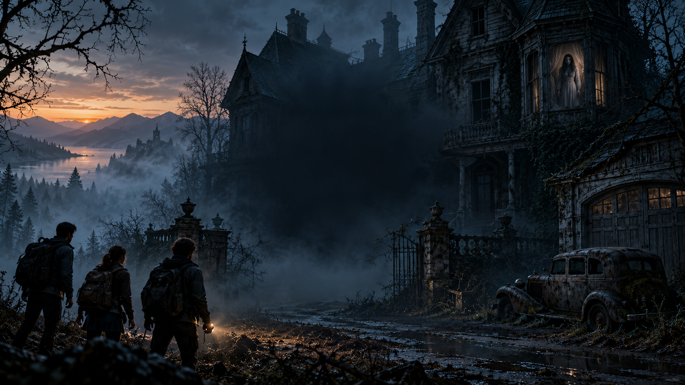

# Waiting for Dawn — v0.8.1

A first-person 3D cooperative horror escape game for Android and Windows, built with Godot 4.5.2. One player hosts; up to three friends join over local Wi-Fi. No account, microphone, analytics, or online service is needed to play.



## Play

Install the APK from [Releases](https://github.com/singusathwik/WaitingforDawn/releases). All peers must use **0.8.1**. Choose **SOLO**, or **HOST ROOM** and give friends your local IP. Friends use **JOIN IP**, mark ready, and the host starts. Android and Windows use the same protocol. The Android package ID and signing identity remain compatible with the preceding Hollow House builds.

Three students enter an abandoned house during a night out. The doors lock behind them. Upstairs, a dead keeper carries a warning about Eleanor, the children she lost, and a chain of twelve keys. Recover the garage key and ignition key, then board the car together **before 6 AM**. A moving in-engine opening uses generated establishing art, offline synthesized narration, and subtitles; it is not a prerendered film.

## Nursery upgrade in 0.8.1

The approved Blender nursery is now four connected rooms, with a modeled cradle, hollow wardrobe, two six-drawer dressers, shelves, beams and aged surfaces. Twelve native drawer parts share the existing search state; cupboard leaves animate and both hiding cameras work. A 2048-pixel texture option reduces this room’s memory use. Baked lighting keeps the room within the mobile light budget.

See the [runtime review](design/rooms/eleanors-nursery/runtime-review.html) and [editable room package](design/rooms/eleanors-nursery/README.md). The 0.8.1 APK is a locally built candidate awaiting human runtime approval before GitHub publication.

## Escape the house

- Twelve keys are randomized within assigned furniture groups. Earlier keys unlock later cabinets, portrait backs and the crypt. Keys are retained in a shared bag and never consumed. Discovery notifications identify the teammate who found an item.
- Aim at one of **81 individual compartments**: drawers, kitchen cupboards, cistern, boxes, under-bed storage, and four hinged family portraits. Open it with the hand. Recovered letters provide story hints; there are no floating key markers.
- Explore the main house, nursery, east wing, attic, boiler/service basements and crypt. A second stair route loops back into the basement.
- Hide in nine cupboards or under five beds. The viewing slit or low camera lets you watch outside. A ghost that witnesses hiding can find you. Close every entrance to stop it entering a room; it cannot be expelled by closing a door behind it.
- Doors, drawers, creaking floor patches and furniture impacts make noise. Ghost investigation starts after 6 / 4.5 / 3 / 2 seconds on Easy / Normal / Hard / Extreme. Actual arrival depends on distance and open routes. Seeing a player can trigger pursuit immediately.
- Breathing, a rising wail, pursuit audio and pulsing red edges warn of danger. The flashlight works only below ground, where ambient light is nearly absent, and occasionally flickers.
- The host controls the dawn clock: **40 / 32 / 26 / 20 real minutes** by difficulty, starting after the opening. The display maps midnight to 6 AM. Dawn causes defeat, including if the four-second escape sequence has not finished.
- Escape requires both final keys and all standing survivors aboard. Downed survivors can be revived or left behind. Everyone down also ends the round. Both endings support restart.

## Controls

| Action | Touch | Desktop |
|---|---|---|
| Move / look | Left joystick / right drag | WASD / mouse |
| Use, search, hide, revive, board | Hand | E |
| Sprint / crouch | Running / crouching person | Shift / Ctrl |
| Basement flashlight | Torch, top left | F |
| Throw bottle | Throwing hand | Q |
| Shared bag | Bag, top right | B |
| Recovered papers | Paper, top left | J |
| Menu | Menu, top left | Esc |

The green bottom bar is stamina. Settings control audio, sensitivity, brightness, touch size, lower texture detail and optional camera motion. Menus, bag and reading **do not pause the world**. Multiplayer is local-network play, not Internet matchmaking.

## Build and verify

Open `project.godot` in **Godot 4.5.2 stable**, let imports complete, and run. Runtime models/textures/audio are included. Blender is only needed to regenerate modeled art.

```powershell
./scripts/test.ps1
./scripts/build.ps1 -Release
```

Release signing requires external environment variables; see [build steps](docs/BUILD.md). Run host fixtures sequentially because they share UDP 28741. See [test evidence](TEST_RESULTS.md), [implementation status](IMPLEMENTATION_STATUS.md), [phone guide](docs/PHONE_GUIDE.md), and [asset attribution](ASSETS.md).

`dawn.gd` owns key dependencies, inventory and clock; `exploration.gd` owns searchable furniture and the opening; `horror_interactions.gd` owns doors, hiding and papers; `game.gd` owns authoritative multiplayer and movement; `atmosphere.gd` owns sound and visual effects. Original modeled additions are reproducible through `scripts/build_mourning_ghost.py` and `scripts/build_architecture.py`.

## Platform limits

This is a playable release candidate, not a claim of commercial photorealistic quality. Imported PBR furniture and the animated character are mixed with procedural architecture and secondary props. Physical-phone frame pacing, battery/thermal behavior, headphone sound balance and phone-to-phone Wi-Fi still need device qualification. iPhone export configuration and mobile controls exist, but **no iOS binary is built or tested**; [Mac/Xcode steps](docs/IPHONE.md) remain required.
