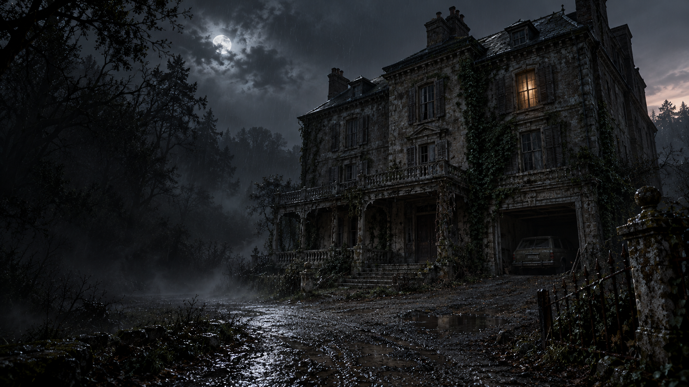

# Waiting for Dawn — v0.8.3

**Unreal rebuild in progress:** the separate [Unreal project](unreal/README.md) targets UE 5.7. It is development source with runtime validation pending, not a new APK release. The playable Godot release described below remains available.

A first-person 3D cooperative horror escape game for Android and Windows, built with Godot 4.5.2. One player hosts; up to three friends join over local Wi-Fi. No account, microphone, analytics or online service is needed.



## Play

Install the APK from [Releases](https://github.com/singusathwik/WaitingforDawn/releases). Everyone in a match must use **0.8.3**. **Play** starts a solo round and closes the menu. **Join with friends** opens the LAN host/join screen; host a room, share the local IP, mark players ready, then start. **Exit** closes the game. Android and Windows use the same protocol and the Android signing identity is unchanged.

Three students enter an abandoned house during a night out. The doors lock behind them. A dead keeper carries a warning about Eleanor, the children she lost, and twelve keys. Recover the garage and ignition keys, then board the car together **before 6 AM**. The opening uses in-engine camera shots, generated establishing art, synthesized male narration and subtitles. **Skip** ends it; retrying a lost round does not replay it.

## Repairs in 0.8.3

- Continuous nursery floor collision, guards along exposed stair/bridge edges, and recovery to the last grounded position after an unexpected fall.
- Aim near a door handle within three metres for its Use prompt and small highlight. The same target drives the action; a noise notice no longer hides it.
- Ghost navigation retains the noise destination behind a closed door, approaches the accessible side and resumes when the door opens. Complete waypoints prevent corner cutting, and blocked patrol destinations do not strand it.
- Original Blender sofas, draped dining tables, fallen chairs, broken crockery/books and nursery toy clutter are integrated into the actual scene. Grime patches and less reflective timber age the rooms.
- Stepping through visible debris disturbs the ghost; crouching avoids it. Ghost footsteps are spatial, response wails originate at the ghost, and nearby lights/toys react to its position. Ordinary player steps remain silent.

See [research and editable assets](design/repair-083/README.md) and [executed checks and limitations](TEST_RESULTS.md). This is an existing-engine repair, **not an Unreal port**.

## Previous 0.8.2 repairs

- Expanding landscape viewport removes the fixed-aspect sidebars. New Play / Join with friends / Exit home screen.
- Ghost starts in an accessible hallway, investigates reported noise long enough to travel between floors, and approaches a closed room from a reachable point. Closed doors still protect a room.
- Ordinary steps are silent. A creak can occur only on marked loose boards after 20–50 travelled steps; drawers, doors, glass and furniture impacts remain noisy.
- Ground-floor garage, nursery level above it, bedrooms on the top level, boiler/service basements and a deeper crypt. Enclosed stairs and landings share the navigation routes. The native Blender nursery remains integrated.
- Original Blender car, hollow drawers, dressers, wardrobes, beds, paneled doors, stove, sink, shelving, radiator, debris, keys and exterior shell. Aged surfaces, rugs and practical lights replace more of the empty staging.
- Storage opens, closes and reopens. Keys become visible inside an opened compartment; aim and use again to take one. Cupboard fronts and under-bed entry points have explicit prompts.
- Flashlight works upstairs as well as below ground. Basements remain almost completely dark without it. Ominous narration replaces the earlier voice, and the ghost is hidden for the whole introduction.
- Visible exterior garage shutter/key plate and a car that drives out during escape. Retry resets the car, locks, keys, clock and storage.

See [test evidence](TEST_RESULTS.md), [implementation limits](IMPLEMENTATION_STATUS.md), and [editable repair assets](design/repair-082/README.md).

## Escape the house

Twelve keys are randomized within assigned furniture groups. Earlier keys unlock later cabinets, portrait backs and the crypt. Keys are retained in a shared bag and never consumed. Discovery notifications identify the teammate who found an item. There are **81 individually searchable compartments**, including drawers, boxes, cisterns and turning portraits. Story papers suggest connections without naming exact key locations.

There are 17 hiding places across cupboards and beds. One survivor fits in each; a ghost that witnesses hiding can find them. Close every entrance to stop it entering a room. Closing a door cannot expel a ghost already inside.

Noise investigation starts after **6 / 4.5 / 3 / 2 seconds** on Easy / Normal / Hard / Extreme. Travel time depends on distance and open routes; this is not an instant spawn at every drawer. Sight can trigger pursuit immediately. Wails, breathing, pursuit sound and red edges warn of danger.

The host controls a **40 / 32 / 26 / 20 minute** countdown, starting after the opening and mapping midnight to 6 AM. Dawn causes defeat, including during the four-second escape. Both final keys and all standing survivors aboard are required; downed survivors can be revived or left behind. Everyone down also ends the round.

## Controls

| Action | Touch | Desktop |
|---|---|---|
| Move / look | Left joystick / right drag | WASD / mouse |
| Use, search, hide, revive, board | Hand | E |
| Sprint / crouch | Running / crouching person | Shift / Ctrl |
| Flashlight | Torch, top left | F |
| Throw bottle | Throwing hand | Q |
| Shared bag | Bag, top right | B |
| Recovered papers | Paper, top left | J |
| Menu | Menu, top left | Esc |

The green bottom bar is stamina. Settings control audio, sensitivity, brightness, touch size, nursery texture detail and optional camera motion. Menus and reading do not pause the multiplayer world. Multiplayer is LAN play; Internet matchmaking and host migration are not included.

## Build and verify

Open `project.godot` in **Godot 4.5.2 stable**, allow imports, then run. Runtime art/audio is included. Blender 4.3.2 is only needed to regenerate the authored meshes.

```powershell
./scripts/test.ps1
./scripts/build.ps1 -Release
```

Signing uses external environment variables; see [build steps](docs/BUILD.md). Run host fixtures sequentially because they share UDP 28741. See the [phone guide](docs/PHONE_GUIDE.md) and [asset attribution](ASSETS.md).

`estate_layout.gd` owns the stair geometry/navigation; `repaired_art.gd` binds the new meshes; `home_screen.gd` owns the home page. Existing modules retain authoritative networking, key dependencies, search state, hiding, audio and the dawn clock.

## Platform and art limits

This repair build mixes original modeled assets, imported PBR furniture and procedural architecture. It does not reach the photorealism of the reference images. Physical-phone performance, thermals, headphone mix and phone-to-phone Wi-Fi still need device qualification. The test evidence distinguishes automated gameplay fixtures and emulator rendering from a human touch playthrough. iPhone configuration exists, but **no iOS binary is built or tested**; [Mac/Xcode steps](docs/IPHONE.md) remain required.
