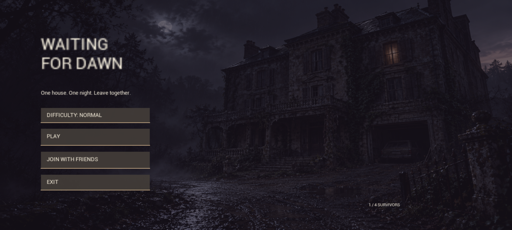
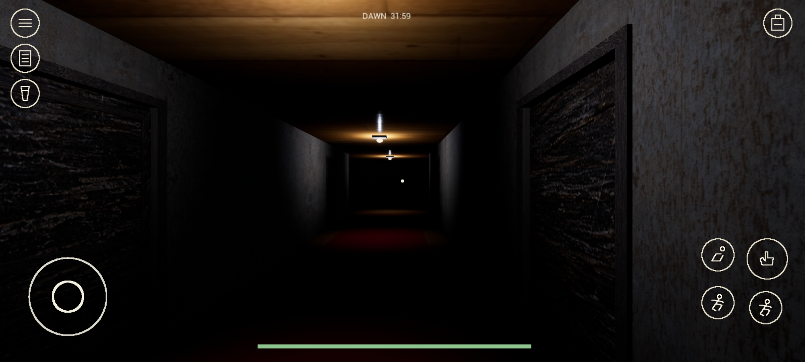
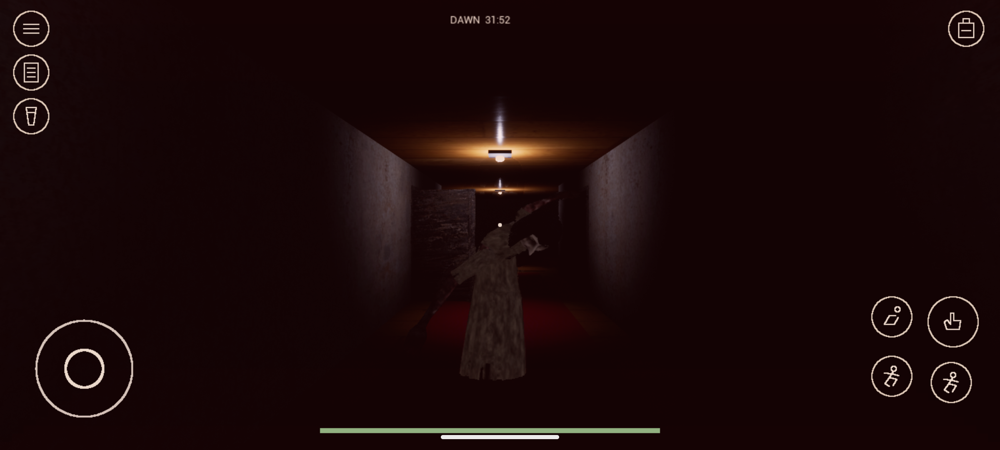
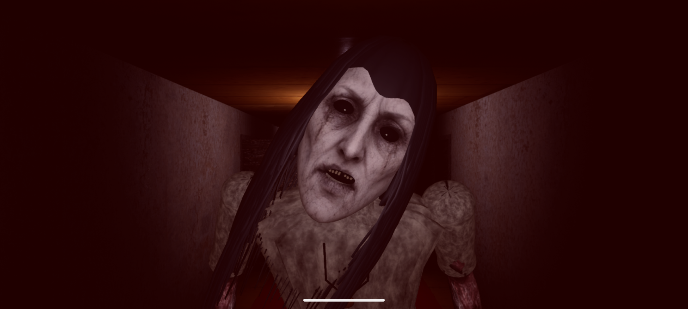
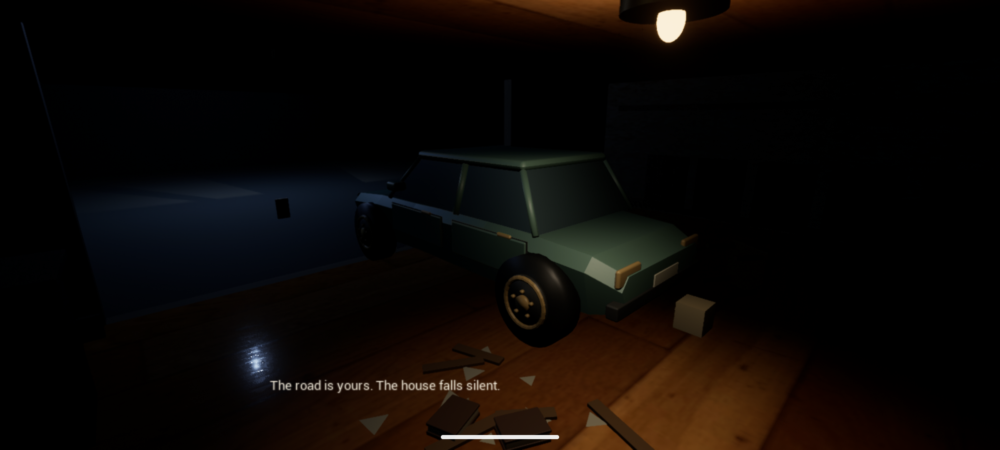
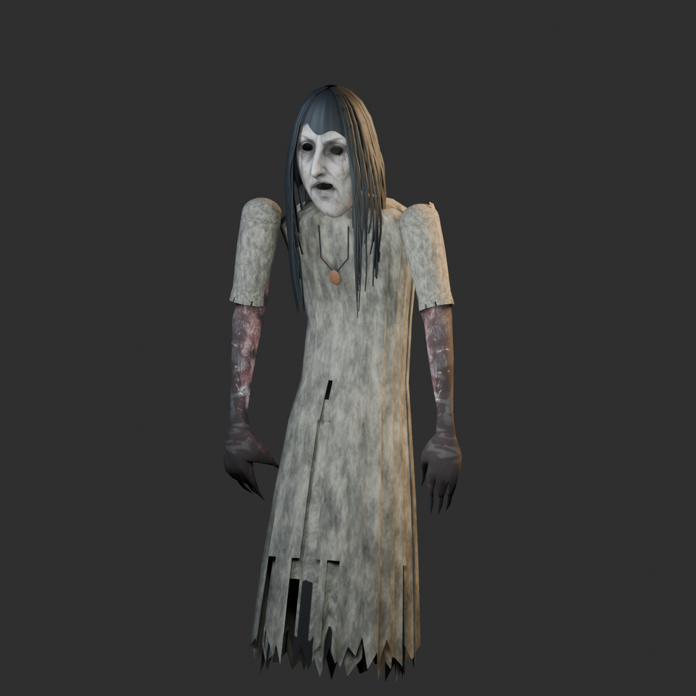

  

<h1 align="center">Waiting for Dawn</h1>

<b>One house. One night. Leave together.</b> 
A first-person cooperative horror escape game for 1–4 survivors.

  
  
  
  

  <a href="https://github.com/singusathwik/WaitingforDawn/releases/download/unreal-v0.9.4/WaitingForDawn-Unreal-0.9.4-arm64.apk"><b>Download Android APK</b></a>
  &nbsp; · &nbsp; <a href="https://github.com/singusathwik/WaitingforDawn/releases/tag/unreal-v0.9.4">Release notes</a>
  &nbsp; · &nbsp; <a href="unreal/README.md">Play &amp; build</a>
  &nbsp; · &nbsp; <a href="docs/GAME-DEVELOPMENT-PROMPTS.md">Game creation prompts</a>

Current Android home screen, captured in the 0.9.4 emulator build. The menu background is illustrated artwork.

## The house remembers

A midnight trip brings a group of students to a house that should have been empty. The doors close behind them. Upstairs, a dead keeper and his letter point toward Eleanor, the children she lost, and the secrets still locked inside.

Search the rooms. Listen before opening another drawer. Hide when Eleanor approaches. Find the garage and ignition keys, gather the surviving team, and leave **before dawn**.

| Explore | Survive | Escape together |
| --- | --- | --- |
| **4 floors · 16 rooms** Basement, ground floor, nursery floor and bedrooms, connected by three physical stair flights. | **Listen. Hide. Run.** Noise draws Eleanor toward you. Wardrobes and the space beneath beds offer a chance to disappear. | **12 shared keys · 4 car seats** Unlock the house through a chain of keys. Every living teammate must board before the engine starts. |
| **98 searchable containers** Animated drawers and hinged portraits, with keys exposed inside. | **A visible pursuer** Patrols, searches, corridor chases, door opening and an attack wind-up that gives you time to react. | **A deadline that matters** Four difficulty settings change the time until dawn and the initial noise response delay. |

## Inside Waiting for Dawn

These are actual Android emulator captures from **0.9.3–0.9.4**. Version 0.9.4 changes the launcher icon; its gameplay is unchanged from 0.9.3. Click an image to inspect the full capture.

<table>
  <tr>
    <td width="50%">
       
      <b>Watch the corridors</b> Mobile controls, a shared deadline and places to hide.
    </td>
    <td width="50%">
       
      <b>She heard you</b> A visible chase with a full-screen danger tint.
    </td>
  </tr>
  <tr>
    <td width="50%">
       
      <b>Meet Eleanor</b> The Blender character redesign, rendered in the game.
    </td>
    <td width="50%">
       
      <b>Leave together</b> The car departure sequence after the team boards.
    </td>
  </tr>
</table>

<b>Behind the scenes: Eleanor in Blender</b>

This is an **asset studio render**, separate from the gameplay captures above. The editable Blender source, FBX, baked textures and generated face-reference prompt are in [Eleanor's art folder](design/eleanor-092/). The character retains credited arm geometry and an existing animation rig; see [asset provenance](ASSETS.md).

## Get in. Find the keys. Get out.

**[Download Waiting for Dawn 0.9.4 for Android](https://github.com/singusathwik/WaitingforDawn/releases/download/unreal-v0.9.4/WaitingForDawn-Unreal-0.9.4-arm64.apk)** — approximately 178 MB.

Requires **Android 8+**, **ARM64**, and a compatible Vulkan or OpenGL ES 3.2 GPU. This is a development-signed preview, installed separately from the older Godot app. Physical-phone compatibility and sustained performance still need testing. iOS has not been built or tested.

1. **Choose a difficulty and press Play.** The narrated opening is skippable; retrying skips it automatically.
2. **Explore and search.** Open containers, then pick up exposed keys. Discoveries appear in the team's shared bag. Key locations are fixed.
3. **React to Eleanor.** Listen for breathing, watch the red danger wash, and hide before she sees you. Ordinary room doors buy time, but she can open them.
4. **Open the garage.** Follow the twelve-key progression and find both the garage and ignition keys.
5. **Board the car.** Use the car to take one of four seats. Once every living, connected player is aboard and the garage is fully raised, press **Start Engine**. The departure leads to the victory screen.

Caught or disconnected teammates do not block departure. **Get Out** remains available before departure, and the dawn timer keeps running while seated. The escape is a scripted sequence, not a free-driving mode.

| Difficulty | Time until dawn | Initial noise response delay |
| --- | ---: | ---: |
| Easy | 40 minutes | 6 seconds |
| Normal | 32 minutes | 4.5 seconds |
| Hard | 26 minutes | 3 seconds |
| Extreme | 20 minutes | 2 seconds |

### Bring your friends

For **same Wi-Fi or hotspot** play, use matching game versions: one player hosts and the others use **Join with friends** to enter the host's local IPv4 address. Keep the host's game in the foreground. Connections use UDP port 7777.

Friends in different locations can try an external private VPN using the [remote-play guide](unreal/docs/REMOTE-PLAY.md). Cross-location play has **not** been verified on independent internet connections. Built-in matchmaking, relay service and host migration are not implemented.

## Built, tested, still improving

The project includes source, editable art, build scripts and recorded checks. The [0.9.3 gameplay audit](unreal/docs/VALIDATION-0.9.3.md) documents:

| Exercised area | Recorded result |
| --- | --- |
| Doors, searchables and hiding spaces | **275 component checks** on Windows and another **275** in the Android emulator |
| Keys, stairs, ghost response and escape | **73 campaign checks per platform**, including twelve pickups and the car ending |
| Four-player synchronization | Four separate Windows processes; repeated with **100 ms outgoing delay and 2% packet loss** |
| Android / Windows co-op | Emulator-to-Windows joining, shared pickup, hiding, boarding and synchronized departure |
| Android car controls | Actual touches for boarding, getting out and starting the engine; victory screen captured |

These are bounded automated tests. Campaign probes teleport between room fixtures while physically walking the stairs; network probes grant later keys to isolate the ending. They do not replace an unassisted four-player playthrough or physical-phone testing. The [0.9.4 validation report](unreal/docs/VALIDATION.md) separately covers the icon, APK upgrade and launch checks.

<b>Current limits</b>

- Physical phones, four-phone Wi-Fi, touch comfort, thermals and sustained frame pacing still need validation.
- No save/resume, revive system, public matchmaking or host migration.
- Narration is synthesized. Co-op bodies use Epic template mannequins; custom seated-body and car-entry animations are not implemented.
- Eleanor's ceiling crawl is a visual pose over ground navigation, not unrestricted wall traversal.
- This is a development preview. Executed checks and remaining limitations are recorded with each release.

## Explore the project

| Start here | What you will find |
| --- | --- |
| [Play, controls and build setup](unreal/README.md) | Unreal 5.7.4, Windows / Android toolchain and runnable build commands |
| [Game creation prompt kit](docs/GAME-DEVELOPMENT-PROMPTS.md) | Copy-and-paste briefs for a similar game: level design, Blender assets, AI, co-op and release testing |
| [Source project](unreal/WaitingForDawn/) | C++ gameplay, saved house map and imported runtime assets |
| [Build and validation tools](unreal/tools/) | Packaging, asset preparation and gameplay / multiplayer probes |
| [Latest release](https://github.com/singusathwik/WaitingforDawn/releases/tag/unreal-v0.9.4) | APK, changes and release details |
| [Asset credits](ASSETS.md) | Original, generated and third-party asset provenance and licenses |
| [Legacy Godot project](LEGACY_GODOT.md) | Historical implementation; separate from the current Unreal build |

Found a problem? [Open an issue](https://github.com/singusathwik/WaitingforDawn/issues/new) with the game version, device / Android version, solo or host / client role, steps to reproduce, and a screenshot or short clip. For a floor or door problem, include the room and the nearest staircase or object.

<b>Search quietly. Watch the doors. Leave together.</b>

