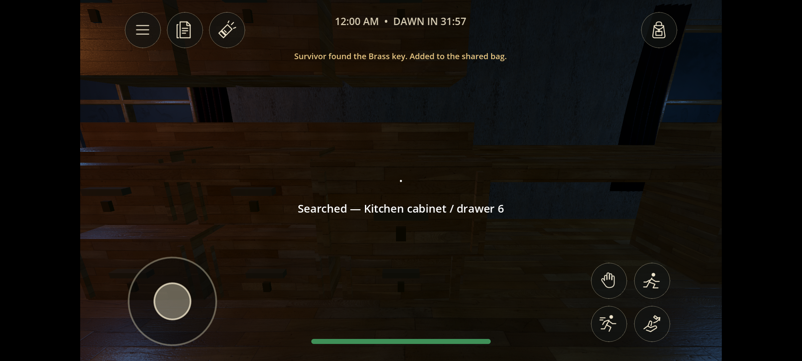
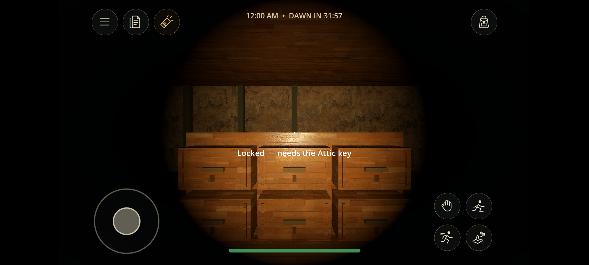
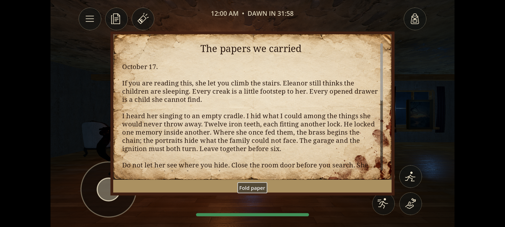

# Waiting for Dawn 0.8.0 validation — 18 October 2026

## Delivered build

- Signed Android APK: **87,764,583 bytes**, version code **8**, version name **0.8.0**, display name **Waiting for Dawn**.
- Package remains `org.hollowhouse.lastride`; minimum SDK 24, target SDK 35; arm64-v8a and x86_64.
- APK SHA-256: `a4663fd5ed92447d086bcf625715e4d8c0242325db5cca40cb1d9144806bdebf`.
- Windows executable SHA-256: `73a6e463fa95fc2be78d2cc5126ae7d14b68b0d90c383b993610ea388035f285`.
- `apksigner verify --print-certs` passed. Retained certificate SHA-256: `a60346ef9fa95c931ce67f3774d9d8bba44e02bf3c1c7a7f8e526f3a2b74bb76`.

## Executed checks

The final `scripts/test.ps1` run completed successfully. [Full regression log](validation-0.8.0/tests-080-final.log).

- Input ownership and bounds, interaction distance, duplicate pickups and cooldowns, shared progress persistence, hiding, revival, garage and team escape, all-down defeat, noise attenuation and ghost targeting.
- Two- and four-process ENet matches: movement replication, disconnects, repeated rounds, version mismatch, active-match joining rejection, capacity, connection timeout, synchronized objectives, remote revival, team boarding, victory and restart.
- Easy, Normal, Hard and Extreme: settings authority, ready reset, stamina behavior and both existing endings. Dawn adds its own loss condition and resets correctly.
- 81 individually aimed search locations, a complete twelve-key dependency chain, locked-storage rejection, crypt gates, four portrait backs, duplicate-use protection, ignition requirement and shared bag data. Key placement is randomized within the defined furniture pools.
- Difficulty noise delays of 6 / 4.5 / 3 / 2 seconds, bounded sound queue, queue reset and connected expanded wings.
- Room-door physics/sight/navigation blocking, reopening, cupboard and bed cameras, occupancy and exits, witnessed-hide capture, proximity warning and scare lifecycle.
- Five skeletal clips, 41-bone rig, animated hand, head anchor and imported architecture/curtains. The clothing additions were rendered and their initial scale error corrected.
- Remote aimed search through real ENet input/action RPCs: key and drawer replication, teammate discovery text, countdown synchronization, duplicate use and round reset.
- iOS configuration/mobile routing/plist XML checks only; these are not iOS runtime tests.

[Physical traversal log](validation-0.8.0/traversal-080-final.log): a real CharacterBody3D walked the complete ordered twelve-key route, searched each selected container, opened the garage and boarded the car, reaching `phase=escaping` with twelve keys. This fixture disables the ghost and accelerates time; it verifies movement/collision/progression, not a human survival playthrough. Separate ending and multiplayer tests verify the victory transition.

## Signed APK checks

Installed the final APK in the Wired_API35 Android emulator with the host GPU. Verified its manifest and retained signature, normal launch, opening story and transition to play, circular controls/joystick, clock, paper readability, bag opening, and cupboard view. Android logs contained a recoverable shader-cache recompilation warning, with no observed script exception or Android crash in these runs.

The final installed APK joined a desktop host through `10.0.2.2`. Actual touch drags aimed at a kitchen drawer and the hand button recovered the Brass key. The host confirmed one shared pickup, drawer-open state, duplicate protection and restart reset. The screenshot shows the discovery notification and synchronized countdown. [Host log](validation-0.8.0/android-search-host-080.log).

A second Android-to-desktop fixture placed the client in the basement: it was visually black with the torch off, a touch on the torch icon lit the room, and the host received `light=true`. [Flashlight host log](validation-0.8.0/android-light-host-080.log).

## Issues caught and fixed

The new crypt lock initially removed navigation edges before they could be cached; setup now caches open geometry before round locks are applied. A decorative cabinet obstructed kitchen approaches and was relocated. Navigation now checks below tabletop height and excludes furniture points, preventing routes through low props. Garage edges remain available behind its disabled navigation point so opening the garage restores its direct route. The physical fixture now walks to the actual search approach and fails immediately if a key is not collected. Restart fixtures were updated to expect the two intentionally locked crypt doors, and clock tests allow the documented one-second synchronization interval. Clothing scale and corpse scale were corrected during visual review.

## Remaining qualification

No physical-phone performance, thermal/battery, headphone mix or phone-to-phone Wi-Fi qualification was performed. The emulator ran without audible output; audio assets and triggers were exercised, but no listening-quality rating is claimed. No iOS binary, App Store submission, Internet matchmaking or exhaustive human difficulty/balance study is included. The cinematic uses generated art, game-engine camera movement and synthesized narration, not a prerendered film. This is a playable release candidate, not a five-star quality certification.

Historical results: [0.7.0](TEST_RESULTS-0.7.0.md).
